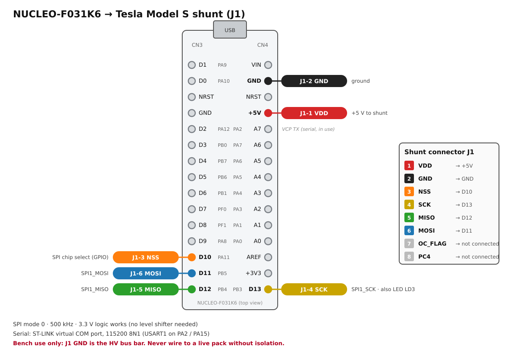

# Shunt reader firmware (STM32F031K6 / NUCLEO-F031K6)

Bare-metal C. No HAL and no CubeMX: just a Makefile, a linker script and register-level code.
It reads the shunt over SPI and streams current to the ST-LINK virtual COM port.

## Get readings

With the board flashed and plugged in over USB, from the `firmware/` folder:

```bash
make monitor
```

That opens a serial terminal (picocom, 115200 baud) on `/dev/ttyACM0` and the current streams in:

```
I = 2.981 A  (raw 59)
I = 3.032 A  (raw 60)
```

`raw` is the shunt's own number; the amps are after calibration (see [Terminal commands](#terminal-commands)).
Type `a` and Enter for an averaged reading. Quit with **Ctrl-A** then **Ctrl-X**.
If the board shows up as a different port, use `make monitor PORT=/dev/ttyACM1`.

## Wiring



| Shunt J1 | Signal | Nucleo pin | MCU pin |
|---|---|---|---|
| 1 | VDD (+5 V) | 5V | n/a |
| 2 | GND | GND | n/a |
| 3 | NSS | D10 | PA11 |
| 4 | SCK | D13 | PB3 (also drives LED LD3, so it flickers) |
| 5 | MISO | D12 | PB4 |
| 6 | MOSI | D11 | PB5 |

The Nucleo's 5V pin comes from USB. That's enough for bench testing on a bare shunt.
**Never** connect this to a shunt that's still in a pack without isolation: J1 GND is the
HV bus bar. The ESP32 project used an SPI isolator for exactly this reason.

### 3.3 V vs 5 V

The shunt's STM8 runs at 5 V, so its guaranteed input-high level is 0.7 × 5 V = 3.5 V. The
STM32's 3.3 V outputs fall below that on paper, but they worked fine on this board.
MISO coming back at 5 V is fine, because PB3/PB4/PB5/PA11 are all 5 V-tolerant.
If every reply is `FF FF ...` or `00 00 ...`:

1. Use a level shifter (e.g. a TXS0108E or 74HCT125 powered from 5 V) on SCK, MOSI and NSS. Or:
2. Build with `make EXTRA_CFLAGS=-DSHUNT_OPEN_DRAIN` and add 4.7 kΩ pull-ups from SCK, MOSI
   and NSS to 5 V. This also requires disconnecting LD3 from PB3 (or the LED clamps SCK).

## Protocol

This comes from [Tom-evnut/Tesla-Current-Shunt](https://github.com/Tom-evnut/Tesla-Current-Shunt):

- SPI mode 0, MSB first, 500 kHz, NSS low for each frame
- 8-byte frames: `cmd, d0..d5, check`. The check byte is **CRC-8, poly 0x07, init 0**. That
  wasn't documented; it was checked against all 7 known frames.
- Init: one 11-byte wake frame, then `4F`, `4E`, `4E`, `16`, `14`, `13`, `17` (see `src/shunt.c`)
- Read current: `41 00 00 00 00 00 00 9A`. Reply bytes 3..6 are a little-endian int32 in mA.

### What this board actually does (measured 2026-11-20)

- Plain 3.3 V signalling works. No level shifter was needed.
- **Replies are one frame late.** The bytes clocked back during a frame answer the *previous*
  frame. The firmware streams `41` reads back to back, so this doesn't matter for current.
  `x` sends your frame, then a `41`, and prints the reply from the second one.
- Reply layout: `[previous cmd] [counter] 00 [d0 d1 d2 d3] [CRC-8]`. The counter's low nibble
  counts 0–F; the high bit sometimes sets (`8C` after `14`, `17` after `7F`), meaning unknown.
  Reply CRCs use the same CRC-8 and all checked out, so the firmware drops any reading that
  fails its CRC or doesn't echo `41`.
- Known registers:

  | Cmd | Reply data | Guess |
  |---|---|---|
  | `41` | int32 mA | current (±7 mA noise at 0 A) |
  | `4F` | `67 E6 1D 00` (1959527) | serial number? |
  | `4E` | `01 02 09 03` | firmware version 1.2.9.3? |
  | `16`, `14`, `13` | echo of what was written | config writes |
  | `17` | `00 00 00 00` | ends init |

- Once, about a minute into testing, the shunt stopped driving MISO entirely. Re-init and an
  STM32 reset didn't help; power-cycling the shunt did. Neither stream pauses nor repeating the
  `x` commands reproduced it, and a 20 s soak at 20 Hz had no errors. Suspect a wiring glitch.
  If you see `no reply` after it had been working, power-cycle the shunt.

First real-current test: 3 A read about 60 raw counts, so on this shunt the raw value is **not**
mA (roughly 50 mA per count). Calibration (`z`, then `c <mA>`) is saved in the last flash page
(0x08007C00) and survives power cycles and reflashing.

## Tools (one-time)

```bash
sudo apt install gcc-arm-none-eabi stlink-tools openocd picocom
```

```bash
sudo usermod -aG dialout $USER
```

Log out and back in after the `usermod`. It's needed to open `/dev/ttyACM0`.

## Build, flash, watch

```bash
make && make flash && make monitor
```

In VS Code (open the `firmware/` folder), *Run Task → build / flash / monitor* works, and
F5 starts a Cortex-Debug session through OpenOCD.

## Terminal commands

Type a command and press Enter. The stream pauses while you type.

| Command | Does |
|---|---|
| `h` | help |
| `s` | stream on/off |
| `p 50` | sample every 50 ms |
| `r` | also print the raw 8 reply bytes |
| `a [n]` | average n readings (default 200, ~2 s); shows amps and raw counts |
| `z` | with **no** current flowing: average 200 readings and save that as zero |
| `c <mA>` | with a known current flowing: average 500 readings and save the scale (negative mA if the current is reversed) |
| `c` | show the saved offset and scale |
| `u` | undo calibration (back to raw counts = mA) |
| `i` | re-send the init sequence and print every reply |
| `x 4F` | send any command. ≤7 bytes get the CRC appended, 8 bytes are sent verbatim |

`x` is for exploring other registers: e.g. `x 42`, `x 43`, ... and watch what comes back.
